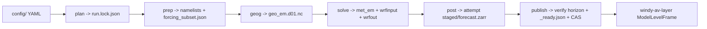
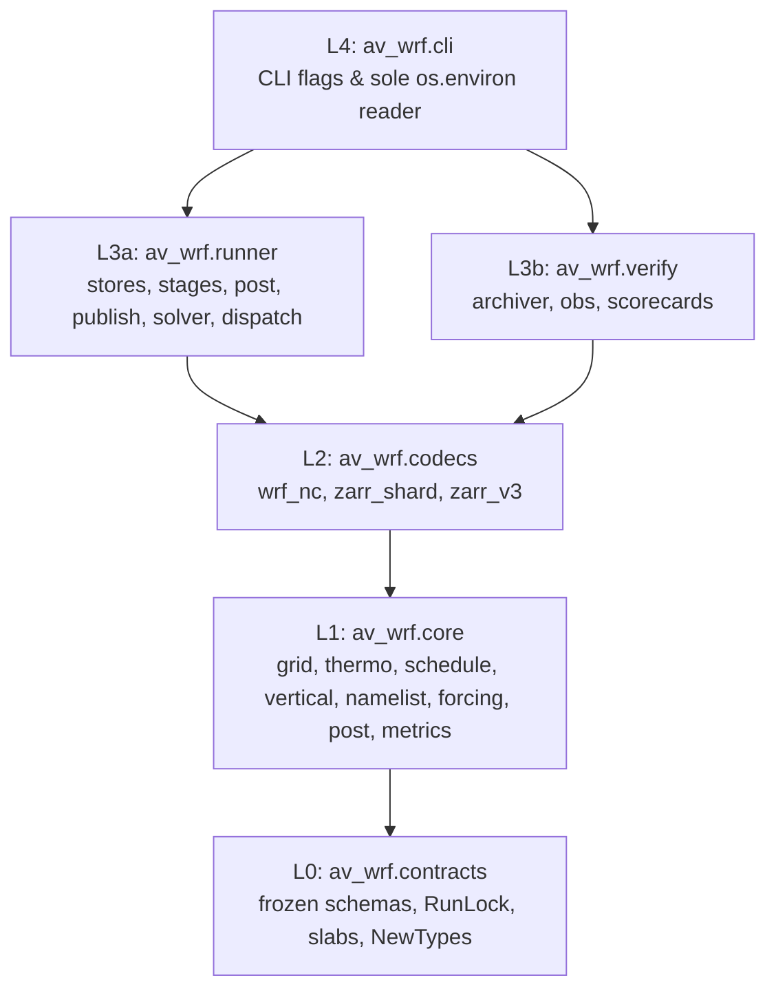

# Architecture

`av-wrf` resolves a declarative product in `config/` into an immutable
`RunLock`, writes Fortran namelists plus a regional forcing cutout recipe during
`prep`, runs `WPS` and `WRF-ARW` inside a pinned Linux container, stages
`Times`-indexed native model-level shards under an attempt prefix, verifies the
complete `RunLock` horizon before promoting `forecast.zarr`, `_diagnostics.json`,
and `_ready.json`, advances `latest.json` via compare-and-swap, and dispatches a
consumer webhook.

## Five-layer acyclic package graph

Imports flow strictly top-down (`L4 -> L3 -> L2 -> L1 -> L0`), enforced by
`scripts/check_repo.py`, [`tach.toml`](../tach.toml), and `import-linter`:

## Codemap

- [`src/av_wrf/contracts/`](../src/av_wrf/contracts/README.md): `ProductSpec`,
  `DomainProfile`, `ScienceProfile`, `ForcingProfile`, `OutputProfile`,
  `CycleWindow`, `RunLock`, `ReadyReceipt`, `DiagnosticsReceipt`,
  `WRF_ZARR_V3_FIELDS`, `Slab2DF32`/`Slab2DI32`/`Slab3DF32`, and nominal types.
- [`src/av_wrf/core/`](../src/av_wrf/core/README.md): pure deterministic modules
  (`grid.py`, `thermo.py`, `schedule.py`, `vertical.py`, `namelist.py`,
  `forcing.py`, `post.py`, `metrics.py`). Peers depend only on `contracts`,
  `core.grid`, and `core.thermo`.
- [`src/av_wrf/codecs/`](../src/av_wrf/codecs/README.md): `wrf_nc.py` indexes
  `wrfout` by `Times` and validates shapes plus `T`/`THM` agreement;
  `zarr_shard.py` encodes multi-step ZEP-0002 `zstd`+`crc32c` shards;
  `zarr_v3.py` builds 30-node `wrf-zarr-v3` metadata.
- [`src/av_wrf/runner/`](../src/av_wrf/runner/README.md): `store.py`
  (`ObjectStore`, `LocalFileStore`, `put_idempotent`), `stages.py` (`check`,
  `plan`, `prep`), `post.py` (attempt staging & weighted diagnostics),
  `publish.py` (full-horizon admission & CAS promotion), `solver.py`,
  `mirrors.py`, and `dispatch.py` (fail-closed webhook).
- [`src/av_wrf/verify/`](../src/av_wrf/verify/README.md): `archiver.py`,
  `observations.py`, and `scorecard.py` for mature-lead evaluation.
- [`src/av_wrf/cli/`](../src/av_wrf/cli/README.md): `env.py` (`RuntimeEnv`) and
  `main.py` (`av-wrf` subcommands).

## Boundary invariants and deliberate absences

- **Region-free code & Dockerfile.** Regions, coordinates, terrain checkpoints,
  and product IDs exist exclusively in `config/`, enforced by `check_repo.py`.
- **Zero consumer science in `av-wrf`.** Parcel thermodynamics, subgrid DEM
  refinement, `samples.bin`, `profiles.bin`, and `.pmtiles` never appear in
  `src/av_wrf/`.
- **Hermetic `contracts` and `core`.** Both layers forbid file I/O, network
  clients, subprocesses, `netCDF4`, `zarr`, `os`, `sys`, `importlib`, `random`,
  and wall-clock calls.
- **Single environment reader.** Only `src/av_wrf/cli/env.py` reads `os.environ`.
- **Mutual isolation at `L3`.** `runner` never imports `verify`; `verify` never
  executes WRF, writes `latest.json`, or dispatches webhooks.
- **Zero type-ignore or mutable records.** Every `@dataclass` in `src/` is
  `frozen=True`; `# type: ignore`, `typing.Any`, `abc.ABC`, and relative imports
  are rejected mechanically.
- **Immutable external truth.** `vendor/producer-contract/`, `docker/patches/`,
  and `tests/oracle/` are locked by SHA-256 in [`manifest.lock`](../manifest.lock).

## External weather & solver specifications

- [WRF v4.8.0 Releases](https://github.com/wrf-model/WRF/releases) &
  [WRF v4.8.0 Known Problems](https://github.com/wrf-model/WRF/wiki/WRF-V4.8.0-Known-Problems)
- [WPS v4.7.0 Releases](https://github.com/wrf-model/WPS/releases) &
  [WPS Best Practices](https://www2.mmm.ucar.edu/wrf/site/documentation/namelist.wps_best_practices.html)
- [WRF Namelist Variables (`auto_levels_opt = 2`)](https://www2.mmm.ucar.edu/wrf/users/wrf_users_guide/build/html/namelist_variables.html) &
  [WRF Users' Guide Ch. 5](https://www2.mmm.ucar.edu/wrf/users/docs/user_guide_v4/v4.4/users_guide_chap5.html)
- [WRF `SINALPHA`/`COSALPHA` Earth Wind Rotation](https://github.com/NCAR/wrf-python/issues/142)
- [Zarr v3 Sharding & Codecs](https://zarr.readthedocs.io/en/stable/api/zarr/codecs/) &
  [GeoZarr](https://github.com/zarr-developers/geozarr-spec)
