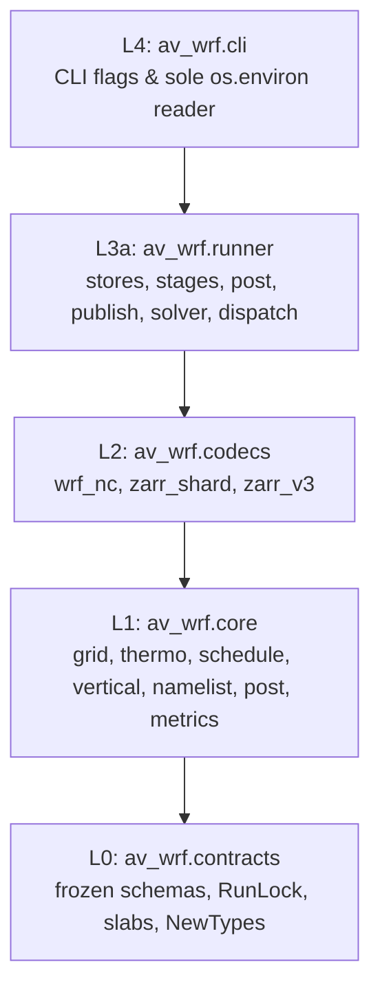

# Architecture

`av-wrf` resolves a declarative product in `config/` into an immutable
`RunLock`, writes Fortran namelists plus a source-cadence forcing cutout recipe
during `prep`, verifies `forcing_manifest.json` and runs `WPS` + `WRF-ARW` inside
a pinned Linux container, stages `Times`-indexed native model-level shards with
`[64, 64]` inner chunks under an attempt prefix, verifies the complete `RunLock`
horizon, commits `_ready.json`, advances `latest.json` via compare-and-swap, and
dispatches a consumer webhook with expiring leases.

```mermaid
flowchart LR
  cfg["config/ YAML"] --> geog["geog -> active-domain geography bundle"]
  geog --> plan["plan -> run.lock.json"]
  plan --> prep["prep -> namelists + forcing_subset.json"]
  prep --> forcing["forcing-manifest -> verified GRIB2 or WPS inventory"]
  forcing --> solve["solve -> met_em + validated wrfinput + wrfout"]
  solve --> post["post -> attempt staged/forecast.zarr"]
  post --> pub["publish -> cycle_lock + verify horizon + _ready.json + CAS"]
  pub --> av["consumer reads _ready.json and forecast.zarr"]
```

## Five-layer acyclic package graph

Imports flow strictly top-down (`L4 -> L3 -> L2 -> L1 -> L0`), enforced by
`scripts/check_repo.py`, [`tach.toml`](../tach.toml), and `import-linter`:

## Codemap

- [`src/av_wrf/contracts/`](../src/av_wrf/contracts/README.md): `ProductSpec`,
  `DomainProfile`, `ScienceProfile`, `ForcingProfile` (`vtable_name`,
  `interval_seconds`), `OutputProfile`, `CycleWindow`, `RunLock`,
  `ForcingManifest`, `SolverReceipt`, `ReadyReceipt`, `DiagnosticsReceipt`,
  `WRF_ZARR_V3_FIELDS`, `Slab2DF32`/`Slab2DI32`/`Slab3DF32`, and nominal types.
- [`src/av_wrf/core/`](../src/av_wrf/core/README.md): pure grid, thermodynamic,
  schedule, vertical-coordinate, and metric calculations. `nesting.py` resolves
  the parent buffer; `namelist.py`, `physics_namelist.py`, and `wps_namelist.py`
  compile Registry-shaped solver and WPS settings. `post_3d.py` builds 3D fields
  and the sampled Courant proxy; `post.py` assembles surface fluxes and frames.
- [`src/av_wrf/codecs/`](../src/av_wrf/codecs/README.md): `wrf_nc.py` and
  `wrf_nc_grid.py` reject NetCDF masks/fills, slice `0:k_exp` hyperslabs, verify
  `ZNW` and `XLAT`/`XLONG`, and require `AFWA_CAPE_MU`.
  Live RRTMG post also checks native surface shortwave and daylight albedo.
  `wps_intermediate.py` writes native WPS v5 records for remapped ICON inputs.
  `zarr_shard.py` and `zarr_v3.py` encode ZEP-0002 padded outer shards with
  exact `[64, 64]` inner spatial chunks.
- [`src/av_wrf/runner/`](../src/av_wrf/runner/README.md): `store.py`
  (`ObjectStore`, `LocalFileStore`, `cycle_lock`, `get_with_token`,
  `sha256_file`), `stages.py` (`check`, `plan`, `prep`), `mirrors.py`
  (forcing recipe registry and manifest verification), source adapters for
  GFS, ICON-EU, and IFS (acquisition and WPS inventory), `post.py`,
  `publish.py` + `publish_verify.py` (cycle-locked promotion, decoded column
  admission, committed object hash checks on recovery), `solver.py` +
  `solver_exec.py` (active-domain validation, native execution, child history
  hashes, and stage wall times), `geog.py` (deterministic geography bundles), and
  `dispatch.py` (expiring-lease webhook delivery).
- `runner/s3.py` uses boto3 for signing, credentials, connections and retries;
  the adapter owns conditional operations and opaque ETags. `http_request.py`
  shares Tenacity retries over HTTPX, while source adapters own index parsing,
  snapshot checks and weather admission.
- Local publication builds a sibling tree and atomically renames it under the
  cycle lock. The ready receipt, diagnostics and Zarr group become visible
  together. Object writes sync data and ancestor directories; recovery durably
  adopts visible objects before advancing ready/latest fences.
- S3 publication writes an immutable payload under
  `attempts/<attempt>/<post-manifest-sha256>/`. A conditional create commits the
  cycle's `_ready.json`. Read the Zarr group through its `zarr_relpath` and
  diagnostics beside it. Retention must preserve payloads referenced by ready
  receipts. AWS requires `s3:ListBucket` to distinguish absent keys from
  denied reads.
- The webhook receiver deduplicates by `Idempotency-Key` because an interrupted
  delivery can be retried after its lease expires.
- Published objects have independent storage from staged objects. Keep staging
  for replay to additional destinations. Pass `publish --prune-stage` on the
  final promotion when local staging is no longer needed. Post, promotion
  and prune share an attempt lock on local storage.
- Source recipes admit GRIB or WPS intermediates over the resolved outer domain.
- [`src/av_wrf/cli/`](../src/av_wrf/cli/README.md): `env.py` (`RuntimeEnv`) and
  `main.py` (`av-wrf` subcommands with lazy store handles and `--store-uri` /
  `--prune-stage`).

## Boundary invariants and deliberate absences

- **Region-free code & Dockerfile.** Regions, coordinates, terrain checkpoints,
  and product IDs exist exclusively in `config/`, enforced by `check_repo.py`.
- **Zero consumer science in `av-wrf`.** Parcel thermodynamics, subgrid DEM
  refinement, `samples.bin`, `profiles.bin`, and `.pmtiles` never appear in
  `src/av_wrf/`.
- **Hermetic `contracts` and `core`.** Both layers forbid file I/O, network
  clients, subprocesses, `netCDF4`, `zarr`, `os`, `sys`, `importlib`, `random`,
  and wall-clock calls.
- **Single environment reader.** Only `src/av_wrf/cli/env.py` reads `os.environ`.
- **Observation verification.** The planned scorecard belongs in a separate
  `L3` package with no runtime dependency on `runner`.
- **Zero type-ignore or mutable records.** Every `@dataclass` in `src/` is
  `frozen=True`; `# type: ignore`, `typing.Any`, `abc.ABC`, and relative imports
  are rejected mechanically.
- **Immutable external truth.** `vendor/producer-contract/`, `docker/patches/`,
  and `tests/oracle/` are locked by SHA-256 in [`manifest.lock`](../manifest.lock).

## External weather & solver specifications

- [WRF v4.8.0 Releases](https://github.com/wrf-model/WRF/releases) &
  [WRF v4.8.0 Known Problems](https://github.com/wrf-model/WRF/wiki/WRF-V4.8.0-Known-Problems)
- [WPS v4.7.0 Releases](https://github.com/wrf-model/WPS/releases) &
  [WPS Best Practices](https://www2.mmm.ucar.edu/wrf/site/documentation/namelist.wps_best_practices.html)
- [WRF Namelist Variables (`auto_levels_opt = 2`)](https://www2.mmm.ucar.edu/wrf/users/wrf_users_guide/build/html/namelist_variables.html) &
  [WRF Users' Guide Ch. 5](https://www2.mmm.ucar.edu/wrf/users/docs/user_guide_v4/v4.4/users_guide_chap5.html)
- [WRF `SINALPHA`/`COSALPHA` Earth Wind Rotation](https://github.com/NCAR/wrf-python/issues/142)
- [Zarr v3 Sharding & Codecs](https://zarr.readthedocs.io/en/stable/api/zarr/codecs/) &
  [GeoZarr](https://github.com/zarr-developers/geozarr-spec)
